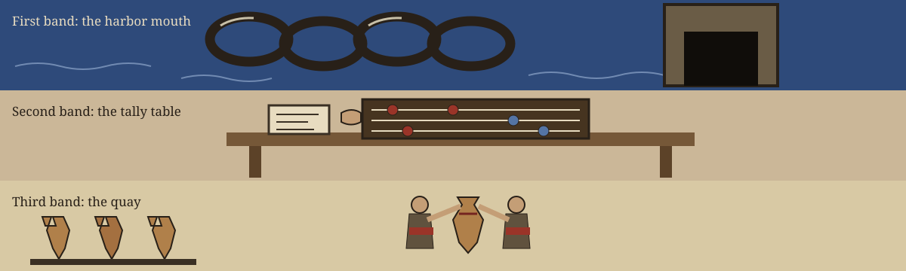

# dm-data-source-attribution-eraser

Chronicle entry, the closing watch: the name above is set in Caprasimo in iron gall, with a small seal picture flanking this title block and the harbor chain link sketched tiny beside this first heading only.

# dm-data-source-attribution-eraser
Removes or modifies metadata associated with data sources (e.g., database server names, file paths, timestamps). Prevents attackers from easily mapping masked data back to its original source or inferring information about the data's lineage or update frequency. - Focused on Tools designed to generate or mask sensitive data with realistic-looking but meaningless values

## Install
`git clone https://github.com/ShadowGuardAI/dm-data-source-attribution-eraser`

> Chronicle scrap, berth four: the retrieval line in the README sails without the hyphen its organisation name ought to carry. It stands here exactly as written. The repair lives on the website, flagged as a repair.

## Usage
`./dm-data-source-attribution-eraser [params]`

## Parameters
- `-h`: Show help message and exit
- `--input`: Path to the input file/directory containing data source metadata.
- `--output`: Path to the output file/directory where anonymized data will be written.
- `--remove-timestamps`: Remove timestamp-related metadata.
- `--remove-filepaths`: Remove file path-related metadata.
- `--remove-servernames`: Remove server name-related metadata.
- `--custom-patterns`: Path to a file containing custom regex patterns to remove. Each pattern should be on a new line.
- `--dry-run`: Perform a dry run without modifying any data. Useful for testing the configuration.

The output file or directory must not be the input file or directory. A run that names the same path for both, in any spelling that resolves to the same path, is refused at exit 1 before any write.

> Chronicle scrap, berth one: output shall not equal input, no matter how the path gets spelled.

At least one removal option must be selected. A run with no removal option, or a run that removes no values, exits 1 with a plain line naming that nothing was removed, writes no output file for that input, and does not log a completed line.

> Chronicle scrap, berth two: a passage stripping nothing earns no completed entry in the log.

Covered timestamp forms: ISO timestamps with a T separator (2023-01-15T10:30:00, with optional fractional seconds and zone), space separated timestamps (2023-01-15 10:30:00), date only forms (2023-01-15), slash dates (15/01/2023 and 2023/01/15), and digit runs of ten or more digits.

Covered server name forms: host names with any top level domain, including .com, .net, .org, .io, and .co.uk, IP addresses, and bare server names that contain the word server, such as db-server-01.

> Chronicle scrap, berth three: coverage reaches five shapes for timestamps, three for server names. The paragraphs above carry the shape lists in full, with their labelled form examples standing inside the preserved record itself.

## License
Copyright (c) ShadowGuardAI

## Kept at the chain tower

The main button of this re-skin reads Strike the Attribution. Its input field label reads Input Path. Its output field label reads Output Path. Its refusal heading reads The Chain Refuses This Passage. Its rehearsal button reads Dry Run First. It ends with the chain link at rest in lamplight, the record kept, the story handed on, and the harbor shut for the night.
